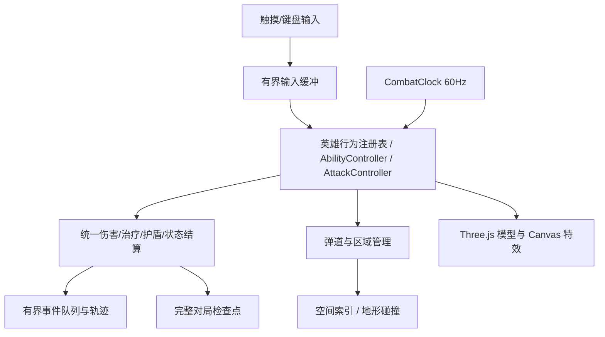

# 当前 4 英雄版本：战斗引擎重构与 ZERO V5 验收

本次以实际存在的艾希、盖伦、光辉、零和治疗技能为基线。用户已确认“先重构当前 4 英雄版本”。没有把缺失的四名英雄或八种召唤师技能伪装成已实现。所有新平衡数值均为本项目自定义数值。

## 原架构的问题与修复

| 原有问题 | 实际修改 |
|---|---|
| 渲染帧直接驱动可变步长战斗 | 独立 60Hz CombatClock；渲染只读逻辑状态 |
| 控制主要使用单个倒计时，不同来源互相覆盖 | 每个来源/技能有独立状态实例、起止时刻、驱散类别和唯一 ID |
| 零专属 W 标记只能存一个来源 | 根据来源 ID 查询多个 ZERO_W_ROOT，净化一个来源不影响其他来源 |
| 减速区域每帧追加减速记录 | 对应来源和区域使用固定键刷新；离开区域立即移除该区域减速 |
| 光辉 E 结束/离开后仍可能残留区域减速 | 清理区域所属记录，爆炸后的配置残留减速独立保留 |
| 技能只按目标粗略去重 | 同一 castId + targetId + hitIndex 去重，保留合法多段伤害 |
| 没有通用击杀、施法、状态事件轨迹 | 统一事件 ID、时间、来源、目标、施法实例和命中序号 |
| 普攻前后摇及动画完全共用 | 四英雄独立时间配置；动画随攻速变化；命中后可取消后摇，不重置攻击间隔 |
| 普攻/技能快速输入直接丢失或可能长期排队 | 每单位最多一个待处理指令，普攻 100ms、普通技能 120ms，执行时重验目标、蓝耗和冷却 |
| 每个单位的近邻判定反复全图查询 | 单位空间分区、最近目标查询、草丛/视野缓存、地形空间分区 |
| 临时弹道、特效和数字反复分配 | 有界对象池；释放时清除单位引用；死亡和失效状态清理 |
| 大量静态岩壁产生大量绘制调用 | 岩壁、岩石、草冠改为实例化批次；屏幕外单位模型剔除 |
| 页面刷新丢失对局成长 | 版本化对象图检查点，保存单位、层数、进化、冷却、状态、弹道和共享命中集合 |

## 新架构与职责

`combat-core.js` 提供时钟、事件、状态、输入缓冲、空间查询、位移基础服务和对象池。`champion-mechanics.js` 保留并扩展原有技能行为，统一处理技能提交、伤害、治疗、护盾、弹道和冷却；`registerBehavior` 允许新增英雄行为，避免复制结算器。普攻和技能状态由该控制器维护，动画只读取时间轴。

技能经历 CAST_START、WINDUP、COMMIT、ACTIVE、RECOVERY、COMPLETE，随后进入 ON_COOLDOWN/READY；取消和打断有独立状态。前摇期间技能被打断不会扣蓝或启动冷却。指向技能在提交时重验射程和不可选中状态；零 Q 提交后继续锁定追踪，普通墙体和其他单位不挡，合法弹道拦截器可以阻挡。

控制服务区分 ROOT、SILENCE、STUN、AIRBORNE、SUPPRESSION、STEALTH、UNTARGETABLE、DAMAGE_IMMUNITY、CC_IMMUNITY、重伤与速度增益。普通净化不会移除压制或击飞。位移服务区分 DASH、BLINK、LEAP、PULL、KNOCKBACK、FORCED_MOVEMENT，并限制地图边界和合法落点；这些基础服务不代表缺失英雄已经制作。

护甲、魔抗、真实伤害、减伤、护盾吸收、生命扣减和击杀统一结算；真实伤害仍可被护盾吸收。重伤作用于治疗，不直接影响护盾。攻击重置区分完整重置、仅后摇取消和下次攻击强化；同一施法的重置有去重键。

## ZERO V5 实际公式

令 S 为熵增、A 为 AP。叠层速度未翻倍：每次施法对同名英雄最多 +1，不同英雄各自 +1；小兵击杀 +1、英雄击杀额外 +5、助攻额外 +3。永久保存，没有总层数上限。

| 技能 | 实际基础公式 | 层数收益 |
|---|---|---|
| Q | 55/85/115/145/175 + 0.40A + Q层数收益 | S≤300：0.8S；超过300：240 + 0.2(S−300) |
| W | 55/80/105/130/155 + 0.35A + W层数收益 | S≤500：0.20S；超过500：100 + 0.05(S−500) |
| E 治疗 | 30/45/60/75/90 + 0.15A + E层数收益 | S≤400：0.30S；超过400：120 + 0.075(S−400) |
| R | 75/130/185 + 0.45A + R层数收益 | S≤625：0.24S；超过625：150 + 0.06(S−625) |

E 隐身/免伤时长为 `min(0.5, 0.25 + 0.001S)`，共用绝对起止时间。治疗仅正常完成时触发一次，受重伤、最大生命限制；前摇或数字化期间被打断不会治疗或加速。禁锢不因 E 自动移除，也不自动打断已经进入数字化的 E。

零基础属性遵循最新文档；普攻距离恢复为 525；Q 距离 600、弹速1300；W 施法距离700、半径260、延迟0.9秒；R 半径750、前摇0.65秒。E 为自身施法。基础移速335，继续应用此前要求保留的全体英雄实际移速倍率0.65，无增减速时实际为217.75世界单位/秒。

伤害的基础、AP 和层数收益在技能提交时取样，同一次范围伤害的所有目标共用这份基础值，避免第一个目标的被动奖励改变后续目标伤害。W 联动则在真正命中每个目标时单独检查；不存在、被净化、已到期或来源死亡的 ZERO_W_ROOT 均不增伤。

### 进化节点

| 层数 | 已实现效果 |
|---|---|
| 40 Q | 主要目标周围200内最多3个其他敌人承受25%未加W倍率的原始伤害；不减速、不递归，主目标不重复计入 |
| 80 W | 预定1.5秒禁锢期之后生成1秒25%减速磁场；提前净化不提前生成，磁场不伤害、不再禁锢、不触发W联动 |
| 140 E | 正常结束获得12%移速1.2秒；不解除控制；打断无此加速 |
| 220 R | 每个命中英雄获得来源独立的3秒过载标记，下一次Q主弹消耗后额外造成30+0.10A魔法伤害 |

过载作为独立命中序号结算，不乘W倍率，不进入溅射，不额外重复奖励同一个 Q 施法对同目标的命中层数。Q 主目标与每个溅射英雄仍可分别奖励一层。进化只解锁一次，可一次跨越多个阈值，死亡保留；技能对象、等级及冷却不会被覆盖。技能边框/说明显示进化与下一阈值，模型增加晶体，Q/R/磁场与过载有独立视觉提示。

## 全八英雄 R 冷却确认表

| 英雄 | 1/2/3级基础CD（秒） | 真实状态 |
|---|---|---|
| 艾希 | 90 / 75 / 60 | 已实现并测试3级、急速、死亡、复活、UI说明 |
| 盖伦 | 85 / 70 / 55 | 已实现并测试3级、急速、死亡、复活、UI说明 |
| 光辉 | 55 / 42 / 30 | 已实现并测试3级、急速、死亡、复活、UI说明 |
| 零 | 90 / 75 / 60 | 已实现并测试3级、急速、死亡、复活、UI说明 |
| 亚索 | 45 / 32 / 20 | 仅保存文档给定配置；英雄不存在，未做英雄回归 |
| 易大师 | 70 / 60 / 50 | 仅保存文档给定配置；英雄不存在，未做英雄回归 |
| 卡兹克 | 65 / 55 / 45 | 仅保存文档给定配置；英雄不存在，未做英雄回归 |
| 瑟提 | 75 / 60 / 45 | 仅保存文档给定配置；英雄不存在，未做英雄回归 |

统一冷却：`FinalCooldown = BaseCooldown × 100 / (100 + AbilityHaste)`，提交时应用一次，控制器统一递减，死亡/复活不刷新 R。仍为 PC_18_COMPAT：上限18级、Q/W/E最高5级、R最高3级并在6/11/16级解锁。未新增15级模式，也未宣称其他英雄已可用。

## 测试与复现

执行 `node test.cjs`：32项原功能/地形回归 + 27项引擎专项 + 20项ZERO V5与恢复测试，共79项。测试内容包括：四英雄全技能、1—18级属性、普攻、前后摇与重置、塔皮、拆塔、死亡复活、胜负、零全部阈值/软上限/联动、范围边界、护盾与控制叠加、伤害去重、15/30/60/120FPS相同战斗结果、144FPS固定时钟、过期输入与恢复后多箭命中去重。

| 实际英雄 | 回归结果与覆盖 |
|---|---|
| 艾希 | P/Q/W/E/R；强化多箭合计一次伤害、扇形去重、两次侦察充能、距离眩晕、恢复中的共享命中集合 |
| 盖伦 | P/Q/W/E/R；清慢、普攻强化及沉默、勇气成长、护盾/减伤/韧性、旋转次数及减甲、真实伤害斩杀 |
| 光辉 | P/Q/W/E/R；双目标禁锢、往返盾叠加、区域减速清理及引爆、1秒固定激光预警及标记消耗 |
| 零 | P/Q/W/E/R；实际命中W联动、软上限、四节点进化、过载、打断、层数及飞行技能恢复 |

| 召唤师技能 | 测试结果 |
|---|---|
| 治疗 | 已实现并测试；沿用原项目250+25×等级、45秒CD；统一治疗/重伤/事件/冷却；没有擅自把其改成未提供的手游版本数值 |
| 闪现、传送、净化、屏障、虚弱、点燃、疾跑、惩戒 | 当前项目均无对应英雄可选技能配置与操作入口，未实现、未测试；部分底层位移/驱散/护盾/重伤服务已可用，但不等同于这8种技能已经完成 |

执行 `node --expose-gc test-stress.cjs`：20秒、1200逻辑帧，8个英雄单位复用4种英雄，200小兵，峰值约1004弹道，多层护盾和控制、10000次高频输入专项、位移及10轮死亡复活。断言覆盖有限坐标、地图内落点、无永久状态锁、事件上限2048、弹道池上限1024及零观察器错误。详细CPU分位耗时和GC堆快照保存在 `engine-benchmark.json`；这是本机Node逻辑测试，不是平板GPU或真机帧率测试。

浏览器已检查正常启动、技能学习及蓝耗、默认关闭自动攻击，以及刷新后继续对局恢复技能等级和战况。页面只读 `#game[data-diagnostics]` 可观察实际逻辑帧时间、画面帧率和绘制调用。一次本机浏览器样本为76个单位、126次绘制调用、逻辑平均约0.858ms；后台/窗口/硬件会影响样本，不能当作平板60FPS保证。

## 地图与交付

保留重做的7200×7200三路、河道、四片野区、空营地、草丛和空龙坑。所有野怪已移除。18座防御塔三个方向模型尺寸×3、受击半径90、射程775；水晶保持原数值。自然金币5/秒。大厅可打开地图总览并显示塔射程。地形参照 [Riot端游地图设计说明](https://www.leagueoflegends.com/en-gb/news/dev/dev-season-2024-map-changes/)，使用原创程序化地形及模型，属于简化布局。

新增文件：`dist/combat-core.js`、`dist/zero-growth.js`、`dist/match-checkpoint.js`、`dist/terrain.js`、`dist/map.html`、`test-harness.cjs`、`test-engine.cjs`、`test-zero-v5.cjs`、`test-stress.cjs`、`test-fixtures/balance-v5.json`、`engine-benchmark.json`、本报告和地形变更说明。

修改文件：`dist/champion-mechanics.js`、`dist/game.js`、`dist/config.js`、`dist/rules.js`、`dist/world.js`、`dist/index.html`、`dist/style.css`、`src/renderer.js`及其构建产物`dist/renderer.js`、`test.cjs`、`test-v4.cjs`、`README.md`。

## 尚未完成或存在边界的内容

- 缺失的四名英雄及八种召唤师技能未新增，遵守本轮确认的4英雄范围。亚索EQ、易大师W重置、卡兹克进化、瑟提双拳等没有进行虚构验收。
- 没有联网多人模式或服务器权威端。本地固定模拟是当前人机对战的结算来源；尚无网络预测、回滚和反作弊。
- 美术仍为原创低多边形模型；不是商业级骨骼动画、音效或官方地图资源。真实平板多点触控、不同GPU、长时间热降频未做真机验收。
- 15—144FPS范围的固定模拟已测试。单帧超过250ms时最多补算15帧并记录丢弃时间，避免无限补帧；极低帧率或长时间卡顿下不承诺真实时间追赶。
- 对局恢复依赖浏览器本地存储和版本一致性；拒绝/清空存储、跨设备、关闭进程时未保存的尾部或未来不兼容版本可能无法恢复。正常更新每2秒保存，页面离开时补存；新开对局会清除原检查点。无云同步。
- 压力测试是有限时长观察，事件/对象池有硬上限；不能据此证明任意时长、任意第三方英雄插件都不泄漏或无错误。
